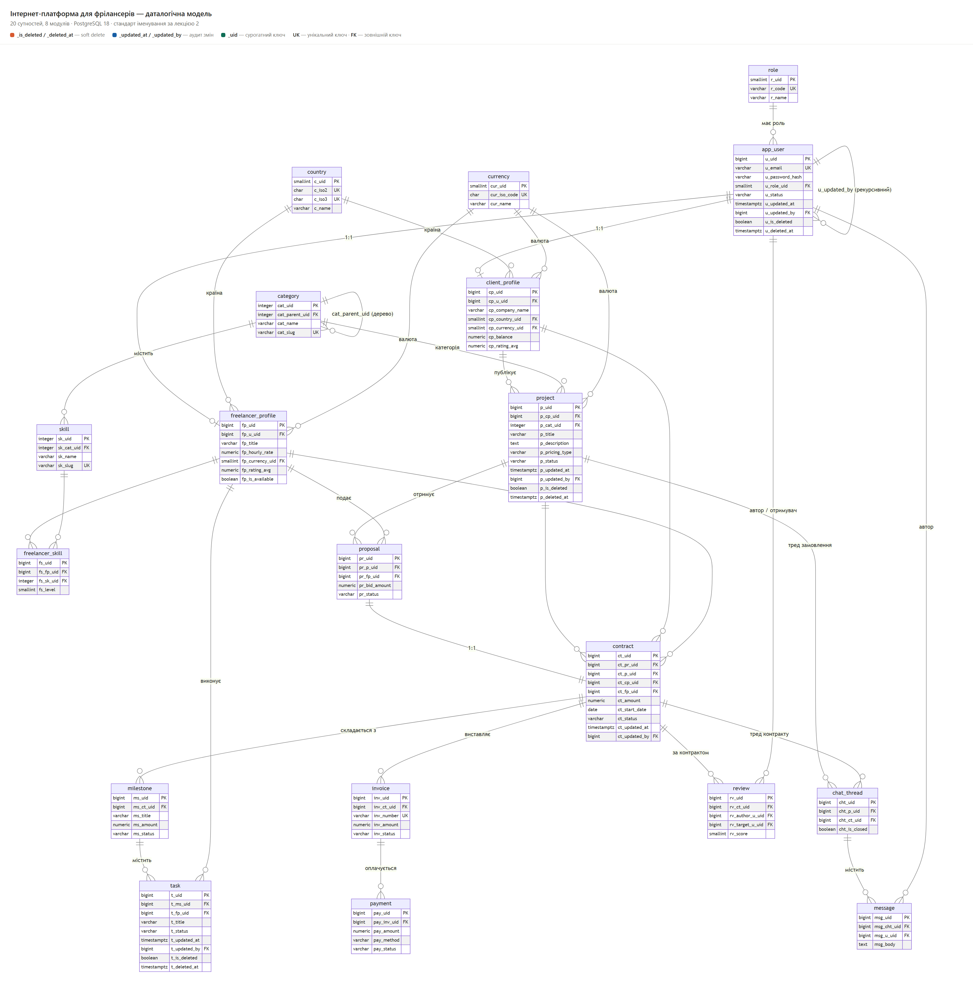

# Інтернет-платформа для фрілансерів

Лабораторна робота з курсу баз даних. СУБД — PostgreSQL, мова — Python.



## Що всередині

- **`sql/`** — створення бази, 19 таблиць, демо-дані, 6 процедур, 4 подання,
  5 функцій, 7 тригерів, 5 індексів
- **`src/`** — шар доступу до даних (Repository + Unit of Work) і демонстрація

## Запуск

Потрібні PostgreSQL 18+ і Python 3.13+.

```
pip install -r requirements.txt
```

Створити базу:

```
psql -U postgres -d postgres -f sql/01_create_database.sql
psql -U postgres -d freelancer_platform -f sql/02_schema.sql
psql -U postgres -d freelancer_platform -f sql/03_seed.sql
psql -U postgres -d freelancer_platform -f sql/04_functions.sql
psql -U postgres -d freelancer_platform -f sql/05_views.sql
psql -U postgres -d freelancer_platform -f sql/06_procedures.sql
psql -U postgres -d freelancer_platform -f sql/07_triggers.sql
psql -U postgres -d freelancer_platform -f sql/08_indexes.sql
```

Запустити демонстрацію:

```
FP_DB_PASSWORD=ВАШ_ПАРОЛЬ python src/demo_lifecycle.py
```

## Як це влаштовано

Застосунок не звертається до таблиць напряму: читає лише через подання
(`v_*`), змінює лише через збережені процедури (`sp_*`). Правило перевіряється
кодом (`src/freelancer/guards.py`), а не дисципліною.

Бізнес-правила живуть у базі: процедури тримають перевірки, тригери —
soft delete і аудит, подання — розрахунки.
## Відповідність вимогам

Нумерація збігається з методичкою; нижче — де саме в репозиторії лежить кожен пункт.

1. **Схема БД зі зв'язками.** `diagram/er-diagram.png` — 19 сутностей,
   кардинальності 1:1 і 1:N, позначені PK, UK, FK, а також окремо — soft
   delete й аудит.

2. **Мінімум 15 сутностей.** 19 таблиць у `sql/02_schema.sql`: `role`,
   `app_user`, `country`, `currency`, `client_profile`, `freelancer_profile`,
   `category`, `skill`, `freelancer_skill`, `project`, `proposal`, `contract`,
   `milestone`, `task`, `invoice`, `payment`, `chat_thread`, `message`,
   `review`. Довідники винесені окремо, а M:N між фрілансером і навичкою
   реалізовано розв'язною таблицею `freelancer_skill` — з власними
   атрибутами (`fs_level`, `fs_years`), яким більше ніде жити.

3. **Soft delete і дата останньої зміни.** М'яке видалення — `app_user`,
   `project`, `task`: пара `is_deleted` + `deleted_at` зв'язана `CHECK`-ом,
   тому прапорець і дата не можуть розійтися. Аудит (`updated_at` +
   `updated_by`) — `app_user`, `project`, `contract`. Обидва правила
   нав'язані тригерами (`trg_softdel_*`, `trg_auditfields_*`): `DELETE`
   перетворюється на `UPDATE`, а час і автора зміни проставляє сама база,
   навіть якщо рядок правлять із `psql`.

4. **Одна з реляційних СУБД.** PostgreSQL 18 (`sql/01_create_database.sql`),
   кодування UTF8.

5. **Процедури, функції, тригери, подання.** 19 об'єктів при мінімумі 10:
   6 процедур (`sp_create_project`, `sp_submit_proposal`,
   `sp_accept_proposal`, `sp_add_milestone`, `sp_issue_invoice`,
   `sp_register_payment`), 2 функції (`fn_current_app_user`,
   `fn_contract_paid`), 7 тригерів, 4 подання. Сутності з п.3 закриті
   тригерами, а бізнес-процес навколо `project` і `contract` — процедурами
   й поданнями. Одна дія `sp_accept_proposal` змінює чотири таблиці
   (контракт, два відгуки, замовлення) в одній транзакції.

6. **Індекси.** 5 індексів, 4 різні типи — B-tree (складений і частковий),
   GIN (повнотекстовий пошук по замовленнях), BRIN (часова вісь переписки),
   Hash (пошук платежу за зовнішнім ідентифікатором). 

7. **Repository + Unit of Work.** `src/freelancer/unit_of_work.py` тримає
   одне з'єднання й одну транзакцію на операцію та роздає її трьом
   репозиторіям (`project`, `contract`, `task`) — тому кілька сутностей
   змінюються атомарно. Репозиторії читають лише подання `v_*`, змінюють
   лише через `CALL sp_*`; правило перевіряє `guards.py` ще до відправки
   запиту на сервер.
